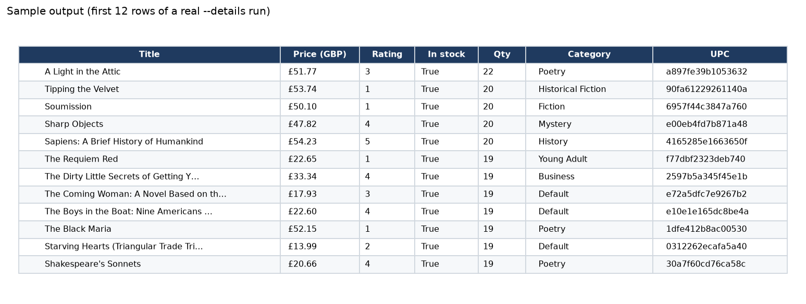
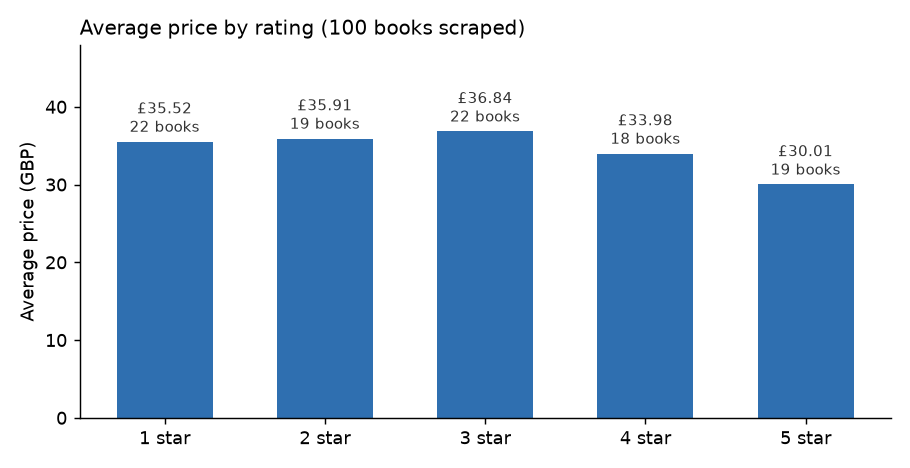

# Web Scraper to Sheets

Scrape a product catalogue, clean and validate the data, and deliver it as CSV, a formatted Excel workbook, or a live Google Sheet, on a schedule.

This demo targets [books.toscrape.com](https://books.toscrape.com), a public sandbox site built for scraping practice. The same structure works for price monitoring, lead lists, stock checks and similar jobs.





The images above were rendered from a real run (`scripts/make_docs_images.py`). The raw files are in [`docs/sample_output.csv`](docs/sample_output.csv) and [`docs/sample_output.xlsx`](docs/sample_output.xlsx), and the console log is in [`docs/sample_run.log`](docs/sample_run.log).

## Features

- Scrapes title, price, star rating and stock status across any number of pages, following pagination until the last page
- Optional `--details` mode visits each product page for exact stock count, UPC and category
- Cleaning and validation: typed fields, whitespace and encoding fixes, rating words to numbers, duplicate removal; invalid rows are logged and dropped, never silently kept
- Exports CSV plus an Excel workbook with a styled header, frozen header row, currency format, auto-filter, sized columns and a summary sheet
- Optional Google Sheets upload through a service account; skipped cleanly with a log message when no credentials are set
- Automatic retries with exponential backoff on 429/5xx responses, a request timeout, a delay between requests and an identifying User-Agent
- Structured logging (`-v` for debug), clear exit codes for schedulers
- Ready-to-edit cron and macOS launchd examples
- 20 pytest tests run against saved HTML fixtures, so they need no network

## Quick start

```bash
git clone https://github.com/rycex1/web-scraper-to-sheets.git
cd web-scraper-to-sheets
python3 -m venv .venv && source .venv/bin/activate
pip install -r requirements.txt
python -m scraper --pages 5 --output output/books
```

That writes `output/books.csv` and `output/books.xlsx`. Real output of that command:

```text
INFO    scraper: Page 1: 20 books
...
INFO    scraper: Page 5: 20 books
INFO    scraper: Scraped 100 rows, kept 100, rejected 0
INFO    scraper.export: Wrote 100 rows to output/books.csv
INFO    scraper.export: Wrote 100 rows to output/books.xlsx
```

## Command-line options

| Option | Default | Description |
|---|---|---|
| `--pages N` | `5` | Listing pages to scrape (20 books each). `0` scrapes every page. |
| `--output PATH` | `output/books` | Output path without extension; `.csv` and `.xlsx` are added. |
| `--details` | off | Also open each book's page for exact stock, UPC and category (one extra request per book). |
| `--delay SECONDS` | `0.5` | Pause between requests. |
| `--no-excel` | off | Write CSV only. |
| `--sheets` | off | Upload to Google Sheets if it is configured (see below). |
| `-v, --verbose` | off | Debug logging, including every URL fetched. |

## Configuration: Google Sheets (optional)

1. In Google Cloud, create a service account, enable the Google Sheets API and download the JSON key.
2. Share your spreadsheet with the service account's email address as an Editor.
3. Copy `.env.example` to `.env` and fill in:

```ini
GOOGLE_SERVICE_ACCOUNT_FILE=./service_account.json
GOOGLE_SHEET_ID=your-spreadsheet-id-from-the-url
```

4. Run with `--sheets`. The `Books` worksheet is replaced with the latest data on each run. If either value is missing, the upload is skipped and the CSV/Excel files are still written.

The key file and `.env` are listed in `.gitignore`.

## Scheduling

- **Linux / macOS cron:** see [`schedule/crontab.example`](schedule/crontab.example) for a daily 06:00 run.
- **macOS launchd:** see [`schedule/com.example.book-scraper.plist`](schedule/com.example.book-scraper.plist); copy it to `~/Library/LaunchAgents/` and `launchctl load` it.
- **Windows:** point Task Scheduler at `.venv\Scripts\python.exe -m scraper --sheets` with the project folder as the start directory.

The command exits with `0` on success, `1` if no valid rows were scraped and `2` for bad arguments, so schedulers and monitoring can tell when a run failed.

## Project structure

```text
web-scraper-to-sheets/
├── scraper/
│   ├── cli.py          # argument parsing, page loop, orchestration
│   ├── fetch.py        # requests session with retry/backoff, polite delay
│   ├── parse.py        # BeautifulSoup parsing of listing and detail pages
│   ├── clean.py        # Book dataclass, validation, de-duplication
│   └── export.py       # CSV, formatted Excel, Google Sheets
├── tests/              # pytest tests + HTML fixtures (no network needed)
├── schedule/           # cron and launchd examples
├── scripts/            # renders the README images from a real run
├── docs/               # sample output, images, run log
├── .env.example
└── requirements.txt
```

## Running the tests

```bash
pip install -r requirements-dev.txt
pytest
```

## Adapting it to another site

Most of the work for a new site is in `parse.py` (the CSS selectors) and the `Book` fields in `clean.py`. Fetching, retries, validation flow, exports and scheduling stay the same. Check the target site's terms and `robots.txt` before scraping it, and keep request rates low.

---

**Need something like this?** I build custom versions: scrapers for your target sites, cleaned exports in the format your team uses, and scheduled runs that deliver to Sheets, Excel, email or a database.

## License

MIT. See [LICENSE](LICENSE).
